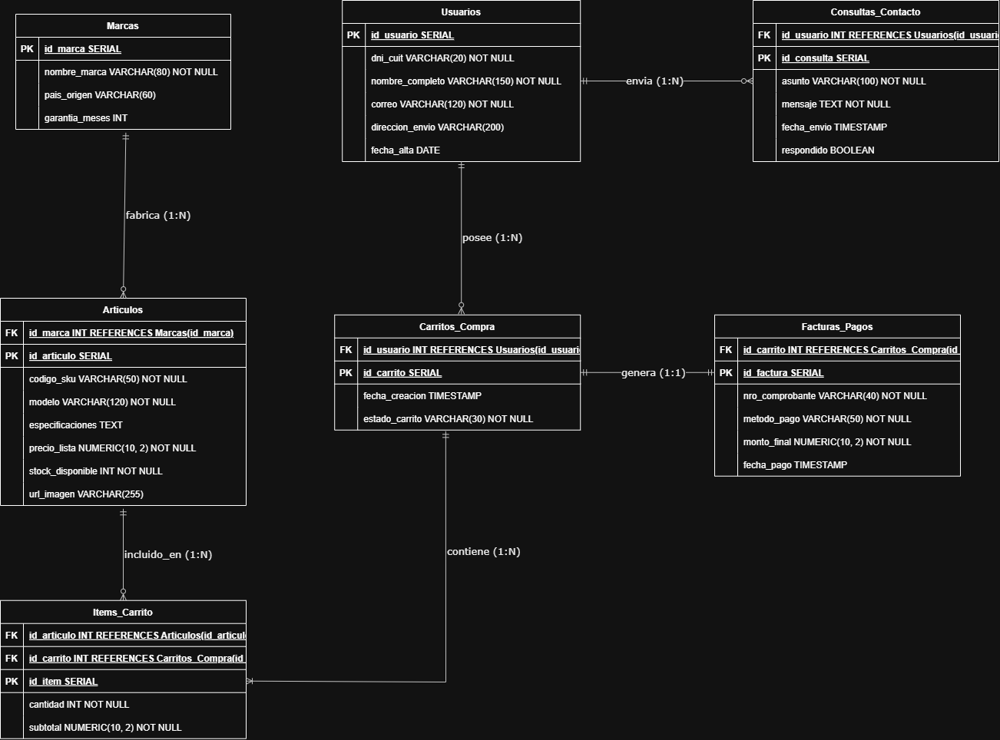
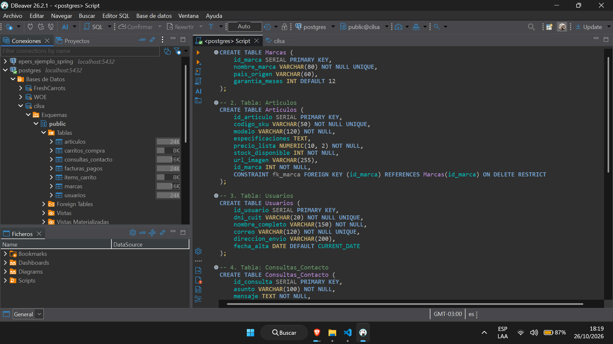

# Trabajo Práctico 2: Diseño e Implementación de Base de Datos - Tienda Digital 
Este documento detalla el proceso de diseño y creación de la base de datos relacional para el proyecto de **Tienda ElectroCilsa**, siguiendo las pautas de la consigna y adaptando la implementación técnica al motor de base de datos **PostgreSQL**.

---

## Paso 1. Formación del Grupo
* **Proyecto:** Tienda Digital de Electrónicos (Catálogo, Carrito de Compras, Facturación y Contacto, etc).
* **Integrantes:** 
  * Flores Matias
  * Valeria Ayala


---

## Paso 2. Herramientas Utilizadas
Aunque la propuesta original sugiere SQLiteStudio, para este proyecto se optó por trabajar con postgresql debido a la familiaridad con el motor de BBDD:
* **Motor de Base de Datos:** PostgreSQL.
* **Gestor Gráfico:** pgAdmin 4 / DBeaver (para la ejecución de consultas y visualización de tablas).
* **Herramienta de Modelado:** draw.io (diagrams.net) utilizando sintaxis **PlantUML** para el trazado del Diagrama Entidad-Relación (DER).

---

## Paso 3. Selección y Diseño del DER
Se diseñó un modelo de datos específico para la tienda de electrónicos del repositorio (que contempla marcas como *Samsung, Xiaomi, Motorola y Logitech*, además de un módulo de contacto web). En lugar de un esquema básico de pedidos, se modeló el flujo completo de **Marcas, Carrito de Compras, Facturación y Consultas de Soporte**.

### Relaciones del Sistema:
1. **Marcas (1) a Artículos (N):** Un fabricante produce múltiples artículos electrónicos, pero cada artículo pertenece a una única marca registrada.
2. **Usuarios (1) a Consultas_Contacto (N):** Un usuario registrado puede enviar varias consultas a través del formulario de contacto de la web.
3. **Usuarios (1) a Carritos_Compra (N):** Un cliente puede gestionar distintos carritos a lo largo del tiempo (activos, abandonados o ya facturados).
4. **Carritos_Compra (1) a Items_Carrito (N) y Artículos (1) a Items_Carrito (N):** Tabla intermedia que resuelve la relación muchos a muchos, detallando qué productos y qué cantidades se agregaron a cada carrito.
5. **Carritos_Compra (1) a Facturas_Pagos (1):** Al confirmarse la compra de un carrito, se emite un único comprobante fiscal de pago asociado.

### Diagrama Entidad-Relación de la Tienda:

---

## Paso 4. Creación de la Base de Datos
A partir del DER diseñado, se creó la base de datos en **PostgreSQL** bajo el nombre representativo `electro_cilsa`.

```sql
CREATE DATABASE electro_cilsa
    WITH 
    OWNER = postgres
    ENCODING = 'UTF8'
    CONNECTION LIMIT = -1;
```

---

## Paso 5. Creación de las Tablas e Identificación de Claves

### 5.1. Diccionario de Datos y Resumen de Claves (PK y FK)

| Nombre de la Tabla | Clave Primaria (PK) | Claves Foráneas (FK) | Tabla Referenciada |
| :--- | :--- | :--- | :--- |
| **Marcas** | `id_marca` | *Ninguna* | - |
| **Articulos** | `id_articulo` | `id_marca` | `Marcas (id_marca)` |
| **Usuarios** | `id_usuario` | *Ninguna* | - |
| **Consultas_Contacto** | `id_consulta` | `id_usuario` | `Usuarios (id_usuario)` |
| **Carritos_Compra** | `id_carrito` | `id_usuario` | `Usuarios (id_usuario)` |
| **Items_Carrito** | `id_item` | `id_carrito`, `id_articulo` | `Carritos_Compra (id_carrito)`, `Articulos (id_articulo)` |
| **Facturas_Pagos** | `id_factura` | `id_carrito` (Única) | `Carritos_Compra (id_carrito)` |

### 5.2. Script SQL de Creación de Tablas (DDL en PostgreSQL)

```sql
-- 1. Tabla: Marcas
CREATE TABLE Marcas (
    id_marca SERIAL PRIMARY KEY,
    nombre_marca VARCHAR(80) NOT NULL UNIQUE,
    pais_origen VARCHAR(60),
    garantia_meses INT DEFAULT 12
);

-- 2. Tabla: Articulos
CREATE TABLE Articulos (
    id_articulo SERIAL PRIMARY KEY,
    codigo_sku VARCHAR(50) NOT NULL UNIQUE,
    modelo VARCHAR(120) NOT NULL,
    especificaciones TEXT,
    precio_lista NUMERIC(10, 2) NOT NULL,
    stock_disponible INT NOT NULL,
    url_imagen VARCHAR(255),
    id_marca INT NOT NULL,
    CONSTRAINT fk_marca FOREIGN KEY (id_marca) REFERENCES Marcas(id_marca) ON DELETE RESTRICT
);

-- 3. Tabla: Usuarios
CREATE TABLE Usuarios (
    id_usuario SERIAL PRIMARY KEY,
    dni_cuit VARCHAR(20) NOT NULL UNIQUE,
    nombre_completo VARCHAR(150) NOT NULL,
    correo VARCHAR(120) NOT NULL UNIQUE,
    direccion_envio VARCHAR(200),
    fecha_alta DATE DEFAULT CURRENT_DATE
);

-- 4. Tabla: Consultas_Contacto
CREATE TABLE Consultas_Contacto (
    id_consulta SERIAL PRIMARY KEY,
    asunto VARCHAR(100) NOT NULL,
    mensaje TEXT NOT NULL,
    fecha_envio TIMESTAMP DEFAULT CURRENT_TIMESTAMP,
    respondido BOOLEAN DEFAULT FALSE,
    id_usuario INT NOT NULL,
    CONSTRAINT fk_usuario_consulta FOREIGN KEY (id_usuario) REFERENCES Usuarios(id_usuario) ON DELETE CASCADE
);

-- 5. Tabla: Carritos_Compra
CREATE TABLE Carritos_Compra (
    id_carrito SERIAL PRIMARY KEY,
    fecha_creacion TIMESTAMP DEFAULT CURRENT_TIMESTAMP,
    estado_carrito VARCHAR(30) NOT NULL,
    id_usuario INT NOT NULL,
    CONSTRAINT fk_usuario_carrito FOREIGN KEY (id_usuario) REFERENCES Usuarios(id_usuario) ON DELETE CASCADE
);

-- 6. Tabla Intermedia: Items_Carrito
CREATE TABLE Items_Carrito (
    id_item SERIAL PRIMARY KEY,
    cantidad INT NOT NULL CHECK (cantidad > 0),
    subtotal NUMERIC(10, 2) NOT NULL,
    id_carrito INT NOT NULL,
    id_articulo INT NOT NULL,
    CONSTRAINT fk_carrito_item FOREIGN KEY (id_carrito) REFERENCES Carritos_Compra(id_carrito) ON DELETE CASCADE,
    CONSTRAINT fk_articulo_item FOREIGN KEY (id_articulo) REFERENCES Articulos(id_articulo) ON DELETE RESTRICT
);

-- 7. Tabla: Facturas_Pagos
CREATE TABLE Facturas_Pagos (
    id_factura SERIAL PRIMARY KEY,
    nro_comprobante VARCHAR(40) NOT NULL UNIQUE,
    metodo_pago VARCHAR(50) NOT NULL,
    monto_final NUMERIC(10, 2) NOT NULL,
    fecha_pago TIMESTAMP DEFAULT CURRENT_TIMESTAMP,
    id_carrito INT NOT NULL UNIQUE,
    CONSTRAINT fk_carrito_factura FOREIGN KEY (id_carrito) REFERENCES Carritos_Compra(id_carrito) ON DELETE RESTRICT
);
```
### Captura de pantalla con las tablas creadas:


---

## Entregables Adjuntos por el Grupo
- [✔] **Diagrama Entidad-Relación (DER):** Imagen generada a partir del bloque PlantUML en draw.io.
- [✔] **Archivo de Base de Datos / Script SQL:** Archivo `.sql` / Backup de la base creada en PostgreSQL.
- [✔] **Captura de Pantalla:** Imagen del entorno de PostgreSQL mostrando el esquema con las 7 tablas creadas.
- [✔] **Identificación de Claves:** Detallada en el punto 5.1 y aplicada mediante `PRIMARY KEY` y `FOREIGN KEY` en el script.